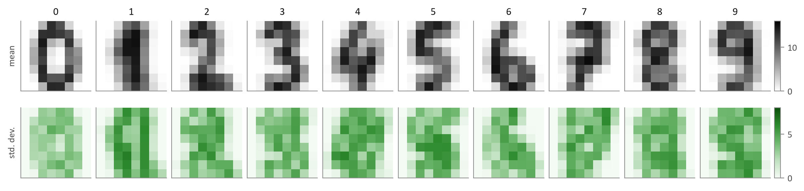
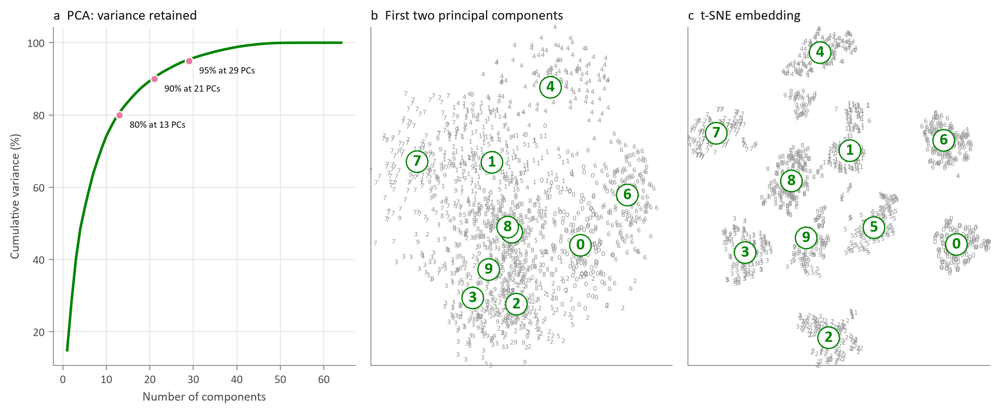
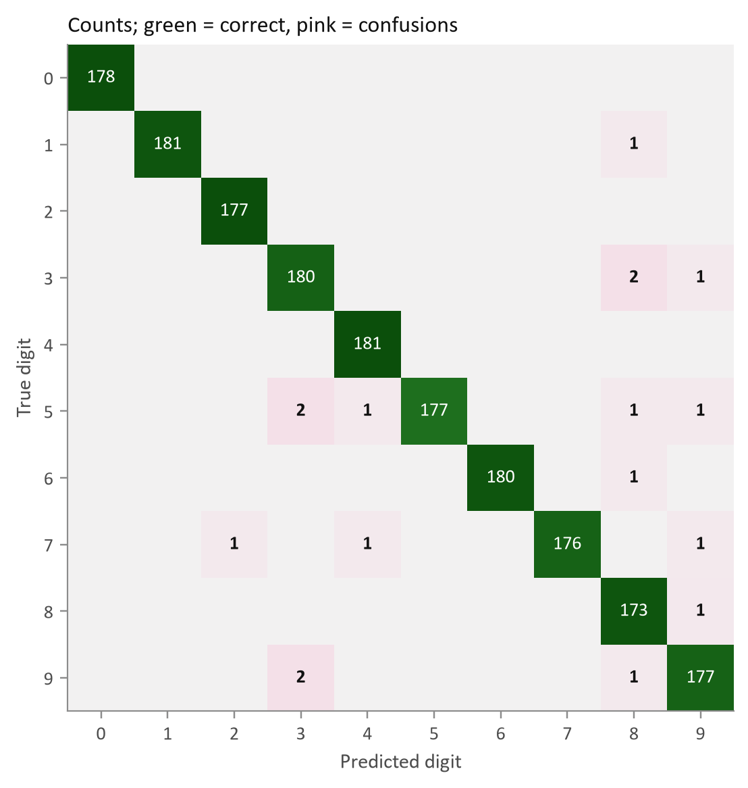
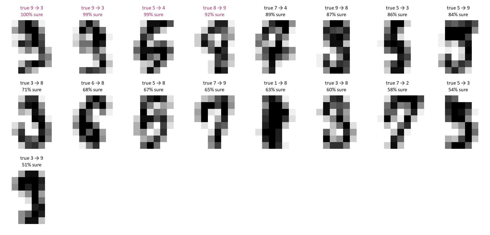

# Teaching a Machine to Read Handwriting

**Exploratory data analysis and a convolutional neural network for optical digit recognition**

Vinith A (25ADL10), III Year B.Tech. Artificial Intelligence and Data Science, KPR Institute of Engineering and Technology
Course U21ADP05 Exploratory Data Analysis and Visualization, Assignment II (case study)

## In one paragraph
Handwritten digits from 43 people (UCI *Optical Recognition of Handwritten Digits*) are explored as **image data**:
sample grids, mean digits, pixel-value and ink distributions, pixel correlation, PCA, t-SNE, anomaly detection and
writer shift. A CNN trained on 30 writers then reads the handwriting of **13 different writers** with
**99.05% accuracy (17 errors out of 1,797)**.

## Dataset
| | |
|---|---|
| Source | E. Alpaydin & C. Kaynak, UCI ML Repository, dataset 80, [doi:10.24432/C50P49](https://doi.org/10.24432/C50P49), CC BY 4.0 |
| File | `data/optdigits.zip` (original archive, read in place) |
| Training | 3,823 images from 30 writers |
| Test | 1,797 images from 13 *other* writers (writer-independent) |
| Fields | 64 pixel counts (0-16, on-pixels in each 4 x 4 block of a 32 x 32 bitmap) + digit label |

## Structure
```
src/common.py              acquire + parse (zip reader, LZW decoder for the original .Z bitmaps, plot style)
src/step2_explore.py       filter + mine: audit, distributions, correlation, PCA, t-SNE, outliers, writer shift
src/step3_train_cnn.py     CNN, 8-configuration grid search, occlusion sensitivity, k-NN and logistic baselines
src/step4_evaluate.py      learning curves, confusion matrix, per-class scores, ROC, errors, calibration, embedding
src/step5_dashboard.py     builds dashboard/index.html (Digit Lab)
notebooks/digit_case_study.ipynb   executed walkthrough of all steps
figures/  results/  report/
```

## Run it
```bash
pip install -r requirements.txt
jupyter nbconvert --to notebook --execute --inplace notebooks/digit_case_study.ipynb
```
Or run the scripts in `src/` in order. Open `dashboard/index.html` in a browser (works offline) to **draw your own digit**
and to browse every test prediction.

## Main exploratory findings
* Clean, balanced and leak-free; the 64 features were rebuilt exactly from the decoded 32 x 32 bitmaps.
* Pixel counts are U-shaped: a 3-component binomial mixture (background / stroke edge / stroke core) replaces a single binomial.
* Total ink is close to normal and similar for all digits, so shape rather than amount identifies a digit.
* Information is local (neighbouring pixels correlate, distant ones do not), which suits convolution.
* t-SNE separates the ten digits (98.6% neighbour purity); 3, 5, 8 and 9 are the hard group.

## Model results (writer-independent test set)
| Model | Accuracy | Macro F1 | Errors |
|---|---|---|---|
| **CNN (32-64 filters, dropout 0.25, shift augmentation)** | **99.05%** | **0.9905** | **17** |
| k-NN (k = 3) | 97.55% | 0.9756 | 44 |
| Logistic regression | 94.44% | 0.9446 | 100 |

CNN vs k-NN: McNemar p = 0.00010. Expected calibration error 0.33%.

| | |
|---|---|
|  |  |
|  |  |

## Report
The full report (PDF and Word) is in [`report/`](report/).

Tested with Python 3.13, TensorFlow 2.21.0, Keras 3.15.1, scikit-learn 1.9.
